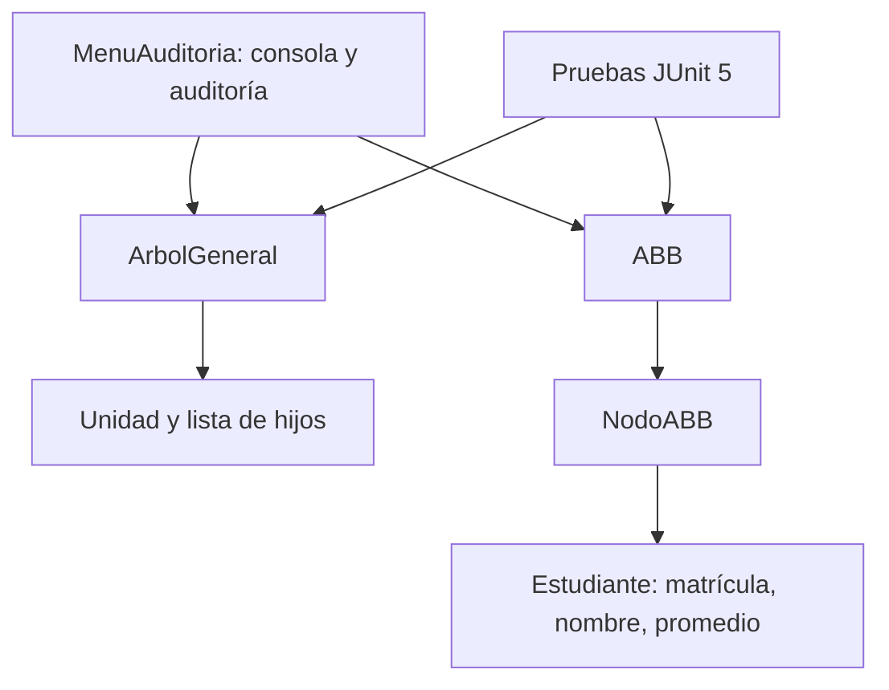

# Sistema de Auditoría Jerárquica y Académica UTA

Aplicación de consola para administrar la jerarquía académica de la UTA y la
matrícula de estudiantes con un árbol general y un árbol binario de búsqueda
(ABB). Se implementó en Java 25 LTS, compatible con el requisito de Java 17 o
superior de la práctica.

## Requisitos

- JDK 25 (LTS)
- Apache Maven 3.9 o superior

## Compilar y ejecutar

Desde la raíz del proyecto:

```shell
mvn test
mvn exec:java
```

La suite contiene 24 pruebas JUnit 5. La salida de auditoría guardada en
[`docs/evidencias/salida-auditoria.txt`](docs/evidencias/salida-auditoria.txt)
se puede regenerar con:

```powershell
"1`n5`n11`n12`n0`n" | mvn -q exec:java
```

## Funcionalidad

### Árbol general

- Construye la jerarquía inicial de nueve unidades: UTA, FISEI, FCHE, FCS,
  SOFTWARE, TI, 3A, 3B y 4A.
- Agrega unidades bajo un padre existente y rechaza códigos duplicados.
- Busca por código y calcula nivel, grado, altura en aristas, cantidad de
  nodos y hojas.
- Imprime la jerarquía con sangría y rechaza eliminar la raíz o unidades que
  todavía tienen descendientes.
- Expone los enlaces de la representación hijo-izquierdo/hermano-derecho.

### ABB de matrículas

- Inserta recursivamente la secuencia de aceptación
  `50, 30, 70, 20, 40, 60, 80, 35, 45, 65, 75, 85`.
- Rechaza matrículas duplicadas y promedios fuera del rango `0..10`.
- Busca y actualiza nombre/promedio sin modificar la clave.
- Incluye recorridos preorden, inorden y postorden; eliminación de hoja, nodo
  con un hijo y nodo con dos hijos mediante sucesor inorden.
- Calcula altura, nodos, hojas, mínimo, máximo, promedio aritmético e
  invariantes del ABB.
- Compara contadores de búsqueda para árboles de igual tamaño: uno insertado
  en orden ascendente y otro con una secuencia más equilibrada. Un ABB no se
  autoequilibra; la altura depende del orden de inserción.

### Auditoría integrada

El menú muestra métricas de ambos árboles y permite comprobar la jerarquía y
la invariante del ABB. La salida de ejemplo incluye también contadores de
comparaciones para búsquedas exitosas y no exitosas.

## Diseño



La búsqueda, inserción, eliminación y recorridos son recursivos; en el ABB las
operaciones de búsqueda/actualización/eliminación cuestan `O(h)`, donde `h` es
la altura. En el peor caso, un árbol sesgado puede tener altura `n - 1` y
coste `O(n)`; un árbol más equilibrado requiere aproximadamente `O(log n)`.
Las métricas y recorridos completos visitan todos los nodos y cuestan `O(n)`.

## Pruebas y casos de aceptación

Ejecutar `mvn test` para verificar 24 casos automatizados entre árboles
vacíos y no vacíos, duplicados, padre inexistente, métricas, eliminación,
promedios, recorridos y transformación de la jerarquía.

Con los datos iniciales se espera:

| Comprobación | Resultado |
|---|---|
| Árbol general | 9 unidades, 5 hojas, altura 3 |
| FISEI y 3B | grado de FISEI 2, nivel de 3B 3 |
| Inorden ABB inicial | 20, 30, 35, 40, 45, 50, 60, 65, 70, 75, 80, 85 |
| Insertar otra matrícula 40 | Rechazada; total sin cambios |
| Eliminar 20, 60 y 70 | Inorden: 30, 35, 40, 45, 50, 65, 75, 80, 85 |
| Eliminar FISEI con descendientes | Rechazado; jerarquía sin cambios |
| Árbol vacío / singleton | Altura -1 / 0, respectivamente |

## Trabajo en equipo y GitHub

Cada integrante debe crear su propia rama `feature/<tema>`, realizar commits
que correspondan a cambios y pruebas reales, y abrir una pull request para que
otro integrante la revise antes de fusionarla. No se deben atribuir cambios a
una persona que no los realizó.

Completar esta tabla con la evidencia real de GitHub al finalizar el trabajo:

| Integrante (usuario GitHub) | Aporte realizado | Rama / commits / pull request |
|---|---|---|
| Pendiente de completar por el grupo | | |
| Pendiente de completar por el grupo | | |
| Pendiente de completar por el grupo | | |
| Pendiente de completar por el grupo | | |
| Pendiente de completar por el grupo | | |

La revisión y la defensa individual deben evidenciarse con la actividad real
de cada integrante en GitHub. Completen la tabla y agreguen capturas tomadas
por el grupo antes de la entrega final.

## Estructura principal

- `src/main/java/com/uta/academico/ArbolGeneral.java`
- `src/main/java/com/uta/academico/Unidad.java`
- `src/main/java/com/uta/academico/ABB.java`
- `src/main/java/com/uta/academico/Estudiante.java`
- `src/main/java/com/uta/academico/MenuAuditoria.java`
- `src/test/java/com/uta/academico/`
- `docs/evidencias/salida-auditoria.txt`
