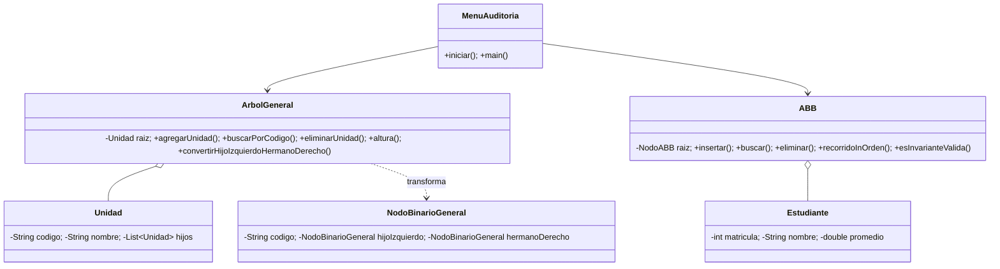

# Sistema de Auditoría Jerárquica y Académica UTA

Proyecto modular de consola en **Java 17** para gestionar el árbol general de unidades académicas, un árbol binario de búsqueda (ABB) de matrículas y una auditoría integrada. Cumple las operaciones y casos de aceptación de la prueba práctica adjunta.

## 👥 Integrantes del Grupo N° 3

| Nombre Completo | Rol / Responsabilidad |
| :--- | :--- |
| **Justin Guanoquiza** | Creador de Repositorio 
| **Edwin Guamanquispe** | Desarrollador 
| **Oseas Ortiz** | Desarrollador 
| **Fernando Villacres** | Desarrollador 
| **Jose Sierra** | Tester / QA 

## Requisitos
- JDK 17 o superior
- Maven 3.9 o superior

## Ejecutar
```bash
mvn test
mvn compile exec:java
mvn compile exec:java -Dexec.args="--demo"
```

La demo imprime los casos de aceptación clave. Las pruebas automatizadas están en `src/test/java/com/uta/academico/`.

## Arquitectura


## Datos base y aceptación
- Jerarquía: UTA → FISEI, FCHE, FCS; FISEI → SOFTWARE, TI; SOFTWARE → 3A, 3B; TI → 4A.
- Resultado esperado: 9 unidades, 5 hojas, altura 3, grado FISEI 2, nivel 3B 3.
- ABB: insertar 50, 30, 70, 20, 40, 60, 80, 35, 45, 65, 75, 85; duplicado 40 rechazado sin alterar el conteo; eliminar 20, 60 y 70 con sucesor inorden para dos hijos.
- La conversión hijo-izquierdo/hermano-derecho crea nodos binarios reales. El hijo izquierdo representa el primer hijo; el hermano derecho enlaza al siguiente hermano.
- La primera unidad agregada sin padre define la raíz. Una raíz no se elimina y una unidad con descendientes no se elimina.

## Complejidad
| Operación | Complejidad |
|---|---:|
| Buscar/agregar/eliminar unidad en árbol general | O(n) |
| Altura, conteo de nodos/hojas del árbol general | O(n) |
| Buscar/insertar/eliminar en ABB | O(h), peor caso O(n) |
| Recorridos, auditoría completa | O(n) |
| Conversión hijo-izquierdo/hermano-derecho | O(n) |

El ABB no se autoequilibra. En la comparación con 127 claves, el árbol ascendente puede alcanzar altura 126, mientras que el árbol construido por medianas tiene altura 6; por ello la búsqueda en cadena requiere muchas más comparaciones (hasta 127), frente a aproximadamente 7 en el equilibrado.

## Evidencias
- `docs/demo.txt`: salida de los casos de aceptación.
- `docs/auditoria.txt`: ejemplo de auditoría integrada.
- `docs/pruebas.txt`: instrucciones y resultado esperado de pruebas.

## GitHub y defensa
La entrega técnica no puede inventar evidencia de colaboración. Añadan al repositorio las ramas `feature/*`, una pull request revisada, commits reales de cada integrante, URL/hash del último commit y capturas de `mvn test`, conforme a las instrucciones del docente.
